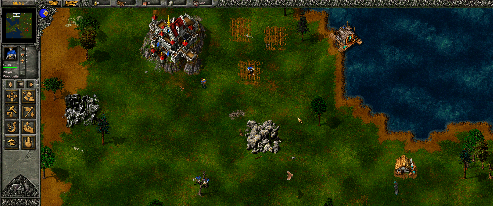

# [Tzar: The Burden of the Crown][tzar] — widescreen resolution mod

An unofficial fan mod that runs [Tzar][tzar] ([Haemimont Games][haemimont], 2000) at a widescreen resolution, such
as 21:9 for an ultrawide monitor, so the game shows more of the map instead of stretching a 4:3 picture.

*The game at 1832x768, scaled to fill a 3440x1440 monitor. The original goes up to 1024x768.*

**Status: works at 1832x768 (21:9) with the panel on the left, tested with the Steam version on Linux (Proton).
There's no installer yet: applying it means changing the game's files by hand, as described in
[CONTRIBUTING.md](CONTRIBUTING.md#applying-it-by-hand).**

## Requirements

- **A copy of the game, bought legally.** The mod is developed against the Steam version,
  [Tzar: The Burden of the Crown][tzar], game version 1.10. Other versions (GOG, the original CD) are untested.
- The mod will never include game files. You need the game installed; the mod only changes it.

## Known issues

- Only the layout with the panel on the left works. With the panel at the bottom or on the right, its buttons end up
  in the wrong places.
- On Linux (Proton), the game can refuse to start with "Invalid TZAR configuration detected" when your sound
  devices change, for example when Bluetooth headphones connect or disconnect. That's the original game, not the
  mod, and its own setup program doesn't run under Proton. The fix is a few numbers in `tzar.ini`, described in
  [CONTRIBUTING.md](CONTRIBUTING.md#applying-it-by-hand).
- Untested: Windows, and multiplayer between patched and unpatched copies.

## Compared to other projects

- [ReTzar](https://github.com/ColCarlo/ReTzar) is a remake of the whole game in Rust and Bevy (GPL-3.0) that uses
  the art and data from your copy of [Tzar][tzar]: a new engine with crisp scaling up to 4K, HD art packs, extras and
  experimental native macOS and Linux builds. This mod goes the other way: it keeps the original 2002 game,
  including its engine, AI and saves, and changes only how big a screen it draws on, with a few bytes of patches and
  config.
- [Tzared](https://tza.red/) is a free remake you play in the browser or as an app, built around online
  multiplayer: ranked games, leagues and lobbies. You don't need the original game. This mod is for playing the
  original itself.

## License

The mod's own files (code, patches, documentation) are released under the [MIT License](LICENSE): use, change and
share them freely. That license covers only what's in this repository.

## The game and its owners

- This is an unofficial fan project. It is not affiliated with, endorsed by or connected to
  [Haemimont Games][haemimont], the developer and Steam publisher of [Tzar: The Burden of the Crown][tzar], or to
  any other publisher of the game.
- [Tzar: The Burden of the Crown][tzar], its executable, data files, artwork, music and trademarks belong to their
  respective owners. This repository contains none of them, and the mod will only ever ship its own changes (patches and
  configuration), never the game's files. The screenshots show the game's art, which belongs to its owners too.
- The mod doesn't remove or get around any copy protection, and it won't. To use it, [buy the game][tzar].
- Back up the game folder before applying anything. On Steam, "Verify integrity of game files" restores the
  original files.

[tzar]: https://store.steampowered.com/app/825730/
[haemimont]: https://www.haemimontgames.com/
